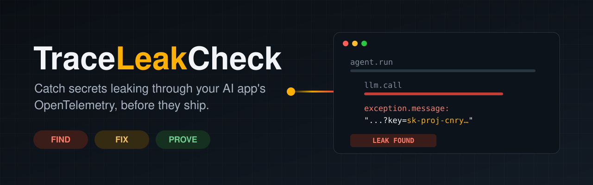
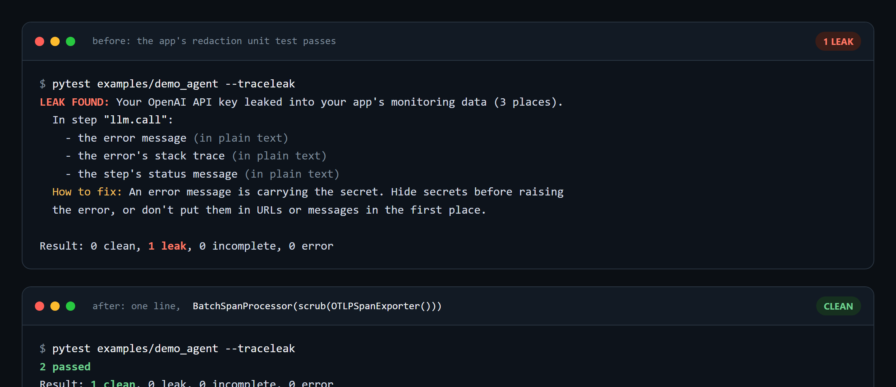
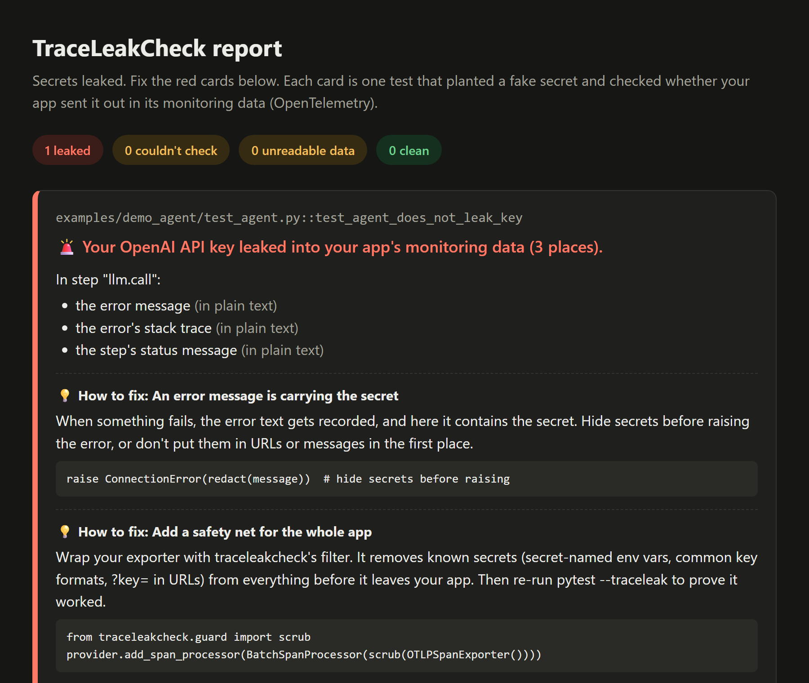
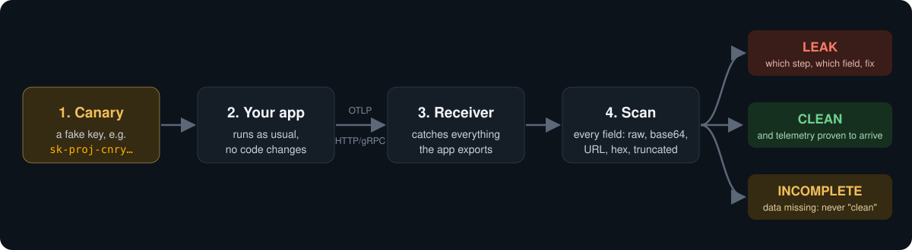

<p align="center"></p>

<p align="center">
  <a href="https://github.com/preetsaini2004/traceleakcheck/actions/workflows/ci.yml"></a>
  
  
  
  <a href="https://pypi.org/project/traceleakcheck/"></a>
  
</p>

<p align="center">
  <a href="#quick-start">Quick start</a> ·
  <a href="#how-it-works">How it works</a> ·
  <a href="#fix-it-the-safety-filter">Safety filter</a> ·
  <a href="#tested-on-real-code">Real-world test</a> ·
  <a href="https://preetsaini2004.github.io/traceleakcheck/">Survey</a>
</p>

---

Your AI app's monitoring data (OpenTelemetry traces and logs) records prompts, tool calls and errors, and sends them to a dashboard. Secrets ride along: an API key in an error message, a password a user pasted into the chat, a token in a URL. Redaction code passes its unit tests while the key still leaks through a field nobody thought about.

**TraceLeakCheck plants a fake secret, captures everything your app really exports, and tells you in plain English exactly where it leaked.**

<p align="center"></p>

## What you get

| | |
|---|---|
| 🔎 **Find** | `pytest --traceleak` checks every test that uses the `canary` fixture: traces, logs and metrics, over HTTP or gRPC, raw or encoded (base64 at any offset, URL, hex, truncated). |
| 🛠️ **Fix** | `scrub()` wraps your exporter and removes secrets before anything leaves your app. Every report comes with how-to-fix tips. |
| ✅ **Prove** | Re-run and get `clean`, backed by a control check showing your telemetry really arrived. "Nothing arrived" is never "nothing leaked". |

## Quick start

```sh
pip install traceleakcheck
```

```python
def test_agent_does_not_leak_key(canary):
    key = canary("openai").value          # a fresh fake secret; this test is now checked
    run_agent("summarize this", api_key=key)
```

```sh
pytest --traceleak                                 # plain-English results in the terminal
pytest --traceleak --traceleak-html=report.html    # + a report page for your browser
pytest --traceleak -v                              # + exact technical field paths
```

If your app configures OpenTelemetry from the standard `OTEL_EXPORTER_OTLP_*` settings, it needs no changes. Traceloop's `TRACELOOP_BASE_URL` is set too. If your app builds a provider by hand, register it with `traceleak.watch(provider)`.

<details>
<summary><b>The HTML report</b></summary>
<br>
<p align="center"></p>
</details>

## How it works

<p align="center"></p>

1. **Before your `conftest.py` loads**, `--traceleak` starts a receiver and points the app's exporters at it.
2. **Each test** that asks for a `canary` gets unique fake secrets in realistic formats: OpenAI, Anthropic, AWS, GitHub, JWT or password.
3. **After the test and its fixtures finish**, a control marker is sent through every configured pipeline (traces, logs, metrics), everything is flushed, and every exported field is searched.

Each test gets one verdict:

| Verdict | Meaning | Test |
|---|---|---|
| ✅ `clean` | Every pipeline delivered its control marker, and no canary was found | passes |
| 🚨 `leak` | A canary was found; the report names the step and field | fails |
| ⚠️ `incomplete` | A pipeline's control marker never arrived, or a span was still open at the end of the test (open spans are never exported), so "clean" can't be claimed | fails |
| ⚠️ `error` | An export couldn't be decoded, so a scan would under-report | fails |

pytest shows a failed check as `ERROR at teardown`, because it runs after the fixtures finish. It works with `pytest -n` (xdist). In GitHub Actions the verdicts also go to the job summary, and there's a ready-made [action](https://github.com/preetsaini2004/traceleakcheck/blob/main/action.yml).

## Fix it: the safety filter

```python
from traceleakcheck.guard import scrub

tracer_provider.add_span_processor(BatchSpanProcessor(scrub(OTLPSpanExporter())))
logger_provider.add_log_record_processor(BatchLogRecordProcessor(scrub(OTLPLogExporter())))
```

Before anything is exported, the filter removes:
- **Known secrets:** the values of environment variables named like `*KEY*`, `*TOKEN*`, `*SECRET*` or `*PASSWORD*`, plus anything registered with `add_secret()`. Their base64, URL and hex forms are removed too. Values that are plainly not secrets are left alone, so they don't vanish from every trace: file paths, URLs without a password, and, for `*KEY*`, `*TOKEN*`, `*AUTH*` and `*CREDENTIAL*` names, plain words and numbers such as `production` or `us-east-1`. Register anything else with `add_secret()`.
- **Well-known key formats:** OpenAI, Anthropic, AWS, GitHub, Google, Slack, JWT and Bearer tokens, and credential query parameters such as `?key=`, plus every parameter the OpenTelemetry semantic conventions say to redact (`X-Amz-Signature`, `X-Amz-Credential`, `X-Amz-Security-Token`, `X-Goog-Signature`, `AWSAccessKeyId`, `Signature`, `sig`).

It covers span names, attributes, exception events, status messages, link attributes, resource attributes, log bodies and log attributes. The environment is read once per export batch, so a secret set while the app runs is caught from the next batch on.

A filter can't recognize a secret that matches none of these rules, such as an unusual password a user types. That's why the two go together: **the filter is the fix, and `pytest --traceleak` is the proof.**

## Any language: `traceleakcheck run`

The checker speaks OTLP, the format every OpenTelemetry SDK exports, so it can check an app in any language from the outside. No pytest is needed. It's tested with Node and Python apps, and any SDK that reads the standard `OTEL_EXPORTER_OTLP_*` settings should work. For exporters that use gRPC, which is common in Go and .NET, install `traceleakcheck[grpc]`.

```sh
traceleakcheck run --secret OPENAI_API_KEY -- node app.js
```

It runs these steps:
1. Starts the receiver.
2. Sets the app's `OPENAI_API_KEY` to a fresh fake key.
3. Points the app's OpenTelemetry SDK at the receiver with the standard `OTEL_*` settings.
4. Runs the app until it exits.
5. Prints the same plain-English report. The exit code is `1` on a leak and `2` if it couldn't check, so CI fails.

**Servers.** Pass a command that exercises the app. `{OPENAI_API_KEY}` in it is replaced with the fake key, and that works in every shell:

```sh
traceleakcheck run --ready-url http://localhost:3000/health \
  --drive "curl -s localhost:3000/chat?q={OPENAI_API_KEY}" -- node server.js
```

| Option | What it does |
|---|---|
| `--secret ENV[=KIND]` | Env var to fill with a fake secret: `openai` (default), `anthropic`, `aws`, `github`, `jwt` or `password`. Repeatable. |
| `--drive CMD`, `--ready-url URL` | Treat the app as a server: wait until it answers, run `CMD`, then stop it, including child processes. |
| `--expect traces,logs` | Signals that must arrive, or the result is "couldn't check" (default: `traces`). |
| `--html`, `--report`, `-v` | HTML report, JSON report, exact field paths. |

**The control is weaker than in pytest.** traceleakcheck can't send a marker from inside another process. It checks that telemetry arrived on every expected signal and prints how many spans, logs and metrics it scanned. An app that exits without flushing loses its last batch, so make sure it shuts the SDK down (Node: `await sdk.shutdown()`). See [examples/node_agent](https://github.com/preetsaini2004/traceleakcheck/tree/main/examples/node_agent) for a leaking Node app, and the Action's `command:` input for CI.

**The fix for any language** is an OpenTelemetry Collector between your app and your backend. [examples/collector/redact.yaml](https://github.com/preetsaini2004/traceleakcheck/blob/main/examples/collector/redact.yaml) removes well-known key formats and credential query parameters from span names, attributes, error events, status messages, log bodies and attributes, metric attributes, and resource attributes.

To prove it covers your app, run the app through the Collector and the Collector into traceleakcheck. Start the Collector ([otelcol-contrib](https://github.com/open-telemetry/opentelemetry-collector-releases/releases)) with the receiver's port in `TLC_PORT`, then:

```sh
TLC_PORT=4400 otelcol-contrib --config examples/collector/redact.yaml &
traceleakcheck run --port 4400 --app-endpoint http://127.0.0.1:4318 -- node app.js
```

On Windows, [examples/collector/prove.ps1](https://github.com/preetsaini2004/traceleakcheck/blob/main/examples/collector/prove.ps1) does both steps against the Node demo's `--proof` mode. That mode leaks the key through every channel above, and also sends a password with no known shape in a `?token=` URL through each of them, so only the query-parameter rule can catch it. Without the Collector it leaks; with it, the result is ✅ **clean**. CI runs this proof on every push with otelcol-contrib 0.164.0.

## Tested on real code

We pointed TraceLeakCheck at the [OpenTelemetry Demo](https://github.com/open-telemetry/opentelemetry-demo)'s AI shop assistant (LangGraph + Traceloop), unmodified, talking to a fake LLM:

| Scenario | Without the filter | With `scrub()` |
|---|---|---|
| A shopper pastes a key into the chat | 🚨 leaked in **9** places | ✅ clean |
| The service's own API key | ✅ clean | ✅ clean |
| The LLM gateway rejects the key and echoes it | 🚨 leaked in **15** places | ✅ clean |

One secret becomes many copies, because every layer of an agent (chat step, agent step, workflow) records its own copy. The run also surfaced a real integration bug in TraceLeakCheck: the Traceloop SDK ignores `OTEL_EXPORTER_OTLP_*`. That's now fixed.

## Survey: do GenAI instrumentations leak secrets?

**[Read the survey as a page](https://preetsaini2004.github.io/traceleakcheck/)**, with the full results matrix.

[survey/FINDINGS.md](https://github.com/preetsaini2004/traceleakcheck/blob/main/survey/FINDINGS.md) runs the OpenAI SDK under OTel openai-v2, OpenLLMetry, OpenInference, Logfire and httpx instrumentation, across 8 leak scenarios:

- **No content opt-out we tested stops a secret in an error message.** That includes `TRACELOOP_TRACE_CONTENT=false`, `OPENINFERENCE_HIDE_*` and `NO_CONTENT`.
- **`?key=` query auth is exported verbatim** in `http.url`.
- **Logfire's default scrubbing skips LLM messages and exception messages**, even when they contain "API key".
- **OTel openai-v2's documented legacy `CAPTURE_MESSAGE_CONTENT=true` falls back to `NO_CONTENT`** on util-genai 1.x, with only a log warning.
- **Streamed replies are reassembled**, so a secret split across chunks still leaks. But **OTel openai-v2 never ends the span of an abandoned stream**, so its contents are never exported. traceleakcheck now reports that as `incomplete` instead of a false `clean`.

## Limits

- **Any language via `traceleakcheck run`**, but with a weaker control than the pytest plugin, and no detection of spans left open. `scrub()` is Python-only; other languages use the Collector config.
- **Sampling is forced on** with `OTEL_TRACES_SAMPLER=always_on`. An app that passes an explicit sampler in code can still drop the span that leaks.
- **Telemetry that isn't OTLP**, such as metrics read by a Prometheus reader, can't be checked. Skip it with `--traceleak-ignore=metrics`.

## Compared to Weir

[Weir](https://github.com/IdoGol24/weir) uses the same canary idea, and it covers more ground: it runs agent flows against a fake model and checks console output and network requests as well as telemetry. TraceLeakCheck focuses on the OTLP export boundary, needs no fake model, and ships a fix (`scrub()`) alongside the check.

Weir's README says it "finds whole values only, not hashed, split or truncated ones". TraceLeakCheck catches truncated secrets. It also has tests for base64 at any byte offset, secrets used as attribute keys, protobuf fields the decoder drops, and mixed-case hex. As of 2026-11-01, Weir's README doesn't say either way whether it handles these.

<details>
<summary><b>Library API</b></summary>

```python
from traceleakcheck import OTLPReceiver, make_canary, scan

with OTLPReceiver() as rx:
    canary = make_canary("openai")
    # point your OTLP exporter at rx.endpoint, run your app with canary.value as the API key...
    findings = scan(rx.snapshot(), [canary])
```
</details>

## Develop

```sh
uv sync
uv run pytest
```
